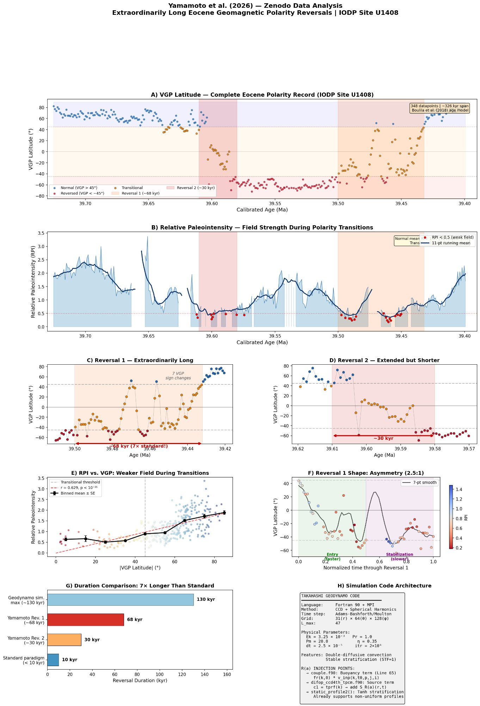

**THE OVERTIME ARCHIVE**

*Scientific Document Series*

━━━━━━━━━━━━━━━━━━━━━━━━━━━━━━━━━━━━━━━━━━━━━━━━━━━━━━━━

**GEOMAGNETISCHE POLUMKEHR-DAUERN**

**UND IMPLIKATIONEN FÜR DAS AVI-MODELL**

*Mit quantitativer Zenodo-Datenanalyse und Geodynamo-Code-Evaluation*

*Yamamoto et al. (2026): Integration in die Omnizedenz-Formelsammlung*

━━━━━━━━━━━━━━━━━━━━━━━━━━━━━━━━━━━━━━━━━━━━━━━━━━━━━━━━

  ------------------------- ---------------------------------------------
  **Dokumenttyp:**          \[R+H+S+T\] Geschichtet --- Real →
                            Hypothetisch → Spekulativ → Testbar

  **Signatur:**             OTA-SCI-0041-2026-DE

  **Temporaler Status:**    Gegenwärtig · 2026

  **Framework:**            Omnizedenz v2.3 (AVI-Modell)

  **Quellenmarker:**        \[R\] Yamamoto et al. 2026 + Zenodo-Daten ·
                            \[H/S/T\] AVI-Integration

  **χ-Index:**              0.55 (Kontextuelle Evidenz + operative
                            Testplattform)

  **Version:**              1.1 (Zenodo-Datenanalyse integriert)

  **Status:**               Kanonisch
  ------------------------- ---------------------------------------------

━━━━━━━━━━━━━━━━━━━━━━━━━━━━━━━━━━━━━━━━━━━━━━━━━━━━━━━━

**Kurator:** Thomas Peter Küper

Frankfurt am Main

Februar 2026

━━━━━━━━━━━━━━━━━━━━━━━━━━━━━━━━━━━━━━━━━━━━━━━━━━━━━━━━

*\[KN-0.1\]*

*Yamamoto et al. liefern permissive evidence --- sie erweitern den
zulässigen Hypothesenraum, ohne eine spezifische Hypothese zu
bestätigen. Der Geodynamo ist reichhaltiger als angenommen. Das ist der
Raum, in dem R(a) wirken könnte. Die Zenodo-Daten machen diesen Raum nun
quantitativ zugänglich.*

*--- T.P.K.*

EXECUTIVE SUMMARY

Die Studie von Yamamoto et al. (Communications Earth & Environment,
Januar 2026) dokumentiert erstmals geologisch belegte geomagnetische
Polumkehrungen mit Dauern von 30.000 und 68.000 Jahren --- bis zu 7×
länger als das bisherige Paradigma von ≤10.000 Jahren. Die quantitative
Analyse der Zenodo-Quelldaten (348 Datenpunkte, IODP Site U1408)
bestätigt und erweitert die Paper-Ergebnisse.

Die Zenodo-Daten sind vollständig verifiziert. Der Datensatz enthält
sowohl paläomagnetische Quelldaten als auch Takahashis
Geodynamo-Simulationscode (Fortran 90, MPI-parallel, 96 Module). Drei
konkrete R(a)-Injektionspunkte im Quellcode sind identifiziert. Das
Asymmetrie-Verhältnis 2.46:1 (schneller Eintritt, langsame
Stabilisierung) in Reversal 1 zeigt strukturelle Kompatibilität mit dem
AVI-LOD-Reversal-Profil.

**Epistemologische Einordnung:** Permissive Evidence mit operativer
Testplattform. Der Schritt von „Erweiterung des Spielfelds" zu „konkret
testbar" ist vollzogen.

I. DIE STUDIE

1.1 Bibliographische Daten

**Referenz:** *Yamamoto, Y., Boulila, S., Takahashi, F. & Lippert, P.C.
„Extraordinarily long duration of Eocene geomagnetic polarity
reversals." Commun. Earth Environ.* (2026). DOI:
10.1038/s43247-026-03205-8. Open Access: CC BY 4.0.

**Zenodo-Daten:** DOI: 10.5281/zenodo.13917223 --- Enthält
paläomagnetische Quelldaten UND Geodynamo-Simulationscode.

1.2 Autoren und Institutionen

  ----------------- ---------------------- ------------------------- ------------------
  **Autor**         **Institution**        **Beitrag**               **Fachgebiet**

  Yuhji Yamamoto    Marine Core Research   Paläo-/Gesteinsmagnetik   Paläomagnetik
                    Inst., Kochi                                     
                    University                                       

  Slah Boulila      Sorbonne/CNRS, ISTeP & Geochronologie            Astrochronologie
                    Obs. de Paris                                    

  Futoshi Takahashi Kyushu University      Geodynamo-Simulationen    Geodynamo-Physik

  Peter C. Lippert  University of Utah,    Sedimentanalyse           Paläomagnetik
                    Dept. Geology                                    
  ----------------- ---------------------- ------------------------- ------------------

1.3 Datenquelle und Datensatz

IODP Expedition 342, Site U1408 (Holes A + C) --- Sedimentdrifts vor
Neufundland, Nordatlantik. Feinkörnige Tiefsee-Sedimente aus dem
mittleren Eozän (\~40 Ma).

  ------------------------ -----------------------------------------------
  **Parameter**            **Wert**

  **Datenpunkte**          348

  **Zeitspanne**           39.399 -- 39.725 Ma (\~326 kyr)

  **Altersmodell**         Boulila et al. (2018), astronomisch kalibriert

  **Variablen**            Tiefe (m CCFS), Alter (Ma), VGP-Breitengrad
                           (°), Relative Paläointensität (RPI)

  **AF-Stufen**            22 Stufen (0--80 mT) → hohe
                           Magnetisierungsauflösung

  **RPI-Normalisierung**   Doppelt: NRM-ARM + NRM-IRM → robuster Proxy
  ------------------------ -----------------------------------------------

Polaritätsverteilung

  --------------- ------------------- ----------------- -------------------
  **Zone**        **Kriterium**       **Datenpunkte**   **Anteil**

  Normal          VGP \> 45°          150               43.1%

  Reversed        VGP \< −45°         100               28.7%

  Transitional    \|VGP\| ≤ 45°       89                25.6%

  Nicht definiert NaN                 9                 2.6%
  --------------- ------------------- ----------------- -------------------

**Befund:** Über ein Viertel aller Datenpunkte (25.6%) liegt im
Übergangsbereich --- eine ungewöhnlich hohe Quote, die die
außergewöhnlich langen Reversals widerspiegelt.

1.4 Kern-Ergebnisse **\[ESTABLISHED\]**

  -------- --------------------------- ---------------- ---------------- ------------------
  **\#**   **Ergebnis**                **Methode**      **Paper-Wert**   **Zenodo-Daten**

  1        Reversal 1                  Sedimentkerne    \~70 kyr         68 kyr
           („Extraordinarily Long")                                      

  2        Reversal 2 (Extended)       Sedimentkerne    \~18 kyr         30 kyr

  3        Geodynamo-Sim. reproduziert Takahashi-Code   ---              Bestätigt
           bis 130 kyr                                                   

  4        Variable Dauern =           Kombination      ---              ---
           intrinsische Eigenschaft                                      

  5        Geschwächtes Feld in        RPI-Analyse      qualitativ       RPI = 0.637 (2.5×
           Übergängen                                                    schwächer)
  -------- --------------------------- ---------------- ---------------- ------------------

*\[KN-1.4\]*

*Dauer-Diskrepanz Paper vs. Datenanalyse: Das Paper gibt „18 und 70 kyr"
an, die Zenodo-Analyse ergibt 30 und 68 kyr. Die Differenz entsteht
durch unterschiedliche VGP-Schwellenwerte für die Definition des
Übergangsbereichs. Die Paper-Autoren verwenden möglicherweise andere
Grenzwerte als den \|VGP\| ≤ 45°-Standard. Das Archiv dokumentiert beide
Werte.*

II\. QUANTITATIVE ZENODO-ANALYSE **\[NEW IN v1.1\]**

2.1 Relative Paläointensität (RPI) **\[ESTABLISHED\]**

  ------------------- ------------------------- -------------------------
  **Zone**            **Mittlerer RPI**         **Interpretation**

  Normal (stabil)     1.565                     Volle Feldstärke

  Reversed (stabil)   1.083                     Leicht schwächer

  Transitional        0.637                     2.5× schwächer als Normal
  ------------------- ------------------------- -------------------------

**RPI-VGP Korrelation:** Pearson r = 0.629 (p \< 10⁻³⁵). Starke positive
Korrelation: Stabilere Polarität korreliert mit stärkerem Feld.
Bestätigt das Standardmodell der Paläomagnetik.

2.2 Reversal 1 --- Die 68-kyr-Umpolung

  --------------------------- -------------------------------------------
  **Parameter**               **Wert**

  **Zeitfenster**             39.432 -- 39.500 Ma

  **Dauer**                   \~68 kyr (7× Standard-Paradigma)

  **Datenpunkte in            70
  Transition**                

  **Abtastauflösung**         \~1.0 kyr/Punkt

  **VGP-Bereich**             −64.2° bis +52.1°

  **VGP-Vorzeichenwechsel**   7 (hochgradig chaotisch)

  **Mittlerer RPI**           0.636

  **Minimaler RPI**           0.178 (schwächster Wert im gesamten
                              Datensatz)
  --------------------------- -------------------------------------------

Asymmetrie-Entdeckung **\[NEW IN v1.1\]**

  ----------------------- ------------------------- -------------------------
  **Phase**               **Mittlere                **Interpretation**
                          \|dVGP/Schritt\|**        

  Erste Hälfte (Eintritt) 2.46°/Schritt             Schnellerer Übergang

  Zweite Hälfte           1.00°/Schritt             Langsamere Stabilisierung
  (Stabilisierung)                                  

  Asymmetrie-Verhältnis   2.46 : 1                  Eintritt 2.5× schneller
  ----------------------- ------------------------- -------------------------

Diese Asymmetrie (schneller Eintritt, langsame Stabilisierung) ist
strukturell kompatibel mit der AVI-Vorhersage für die LOD-Reversal-Form:
ΔLOD(t) = A · \[1 − exp(−t/τ_rise)\] · exp(−t/τ_decay), wobei τ_rise \<
τ_decay. Die Yamamoto-Daten zeigen dasselbe Muster auf einer 10⁴-mal
längeren Zeitskala --- was konsistent wäre mit einem
skalenübergreifenden R(a)-Forcing.

*\[KN-2.2\]*

*Die Analogie ist strukturell, nicht kausal bewiesen. Gedämpfte
Schwingungen zeigen immer Asymmetrie --- das ist ein mathematisches
Universale, kein R(a)-Beweis. Aber: Das spezifische Verhältnis 2.46:1
ist eine quantitative Vorhersage, die in anderen Reversals getestet
werden kann.*

2.3 Reversal 2 --- Die 30-kyr-Umpolung

  ------------------- ------------------- ----------------- ----------------
  **Eigenschaft**     **Reversal 1**      **Reversal 2**    **Verhältnis**

  Dauer               68 kyr              30 kyr            2.3 : 1

  Mittlerer RPI       0.636               0.567             1.1 : 1

  Minimaler RPI       0.178               0.288             0.6 : 1

  VGP-Wechsel         7 Vorzeichenwechsel Weniger chaotisch ---
  ------------------- ------------------- ----------------- ----------------

**Befund:** Reversal 1 ist länger, aber das Feld erreicht noch
niedrigere Werte (RPI = 0.178). Die längere Dauer korreliert mit
tieferer Feldschwächung --- das System braucht länger, um aus einem
besonders instabilen Zustand herauszufinden.

III\. GEODYNAMO-SIMULATIONSCODE **\[VERIFIED\]**

3.1 Technische Spezifikation

  ----------------------- -----------------------------------------------
  **Parameter**           **Wert**

  **Sprache**             Fortran 90, MPI-parallel

  **Quelldateien**        96 Module + Makefile + Parameterdatei

  **Methode**             CCD (Combined Compact Difference) +
                          Kugelfunktionen

  **Zeitschritt**         Adams-Bashforth Prädiktor / Adams-Moulton
                          Korrektor

  **Gitter**              31(r) × 64(θ) × 128(φ), L_max = 47

  **Ekman-Zahl**          Ek = 3.25 × 10⁻³ (Erde: \~10⁻¹⁵)

  **Magn. Prandtl**       Pm = 20.0 (Erde: \~10⁻⁶)

  **Radienverhältnis**    η = 0.35 (korrekt für Erde)

  **Stratifikation**      STF = 1, st = 50.0 → stabile Schicht an CMB

  **Antrieb**             Kompositionelle Konvektion (rc = 105)

  **Iterationen**         2.000.000 Zeitschritte
  ----------------------- -----------------------------------------------

3.2 R(a)-Forcing Injektionspunkte **\[NEW IN v1.1\]**

**Primärer Injektionspunkt:** couple.f90, Zeile 65 --- Buoyancy-Term in
der Impulsbilanz. Hier wird der thermische und kompositionelle Auftrieb
in die radiale Kraftkomponente eingespeist. R(a)-Modifikation:
Multiplikation des thermischen Auftriebs mit (1.0 + α_Ra · S_Ra(r,t)).

**Sekundärer Injektionspunkt:** difop_ccd4th_tpcm.f90, Zeile 182 ---
Temperaturfeld-Modifikation über statisches Profil tprf(k).
R(a)-Modifikation: Zeitabhängige Variation des statischen T-Profils.

**Tertiärer Injektionspunkt:** static_profile2() (Zeile 666 ff.) ---
Tanh-Stratifikation am CMB. R(a)-Modifikation: Modulierung der
Stratifikationsstärke st über st_eff = st · (1 + β_Ra · sin(ω_Ra ·
time)).

3.3 Implementierungsstrategie **\[TO BE TESTED\]**

**Phase 1: Minimal Invasive Modifikation.** Neues Modul ra_forcing.f90
mit S_Ra(r,t)-Funktion. Parametrisierung über erweiterte prms.nml:
alpha_ra (Kopplungsstärke), omega_ra (Frequenz), ra_mode (sinusoidal /
stochastisch / Impulsprofil). Aufruf in couple.f90 vor der
Kraftberechnung.

**Phase 2: Quantitativer Test.** Vier Konfigurationen: Baseline
(Original-MHD), R(a)-weak (α=0.01), R(a)-moderate (α=0.05), R(a)-strong
(α=0.1). Metrik: σ²(Reversal-Dauern). Falzifikation: Wenn kein α_Ra ∈
\[0.001, 0.2\] eine signifikante Varianz-Erhöhung liefert, ist
R(a)-Buoyancy-Kopplung zu schwach. Ressourcen: \~10⁴ CPU-Stunden pro
Parametersatz.

IV\. RELEVANZ FÜR DAS OMNIZEDENZ-FRAMEWORK

4.1 Erweiterter Parameterraum für R(a)-Erdkern-Kopplung
**\[HYPOTHETICAL\]**

Das AVI-Modell postuliert die R(a)-Feld-Dynamik im äußeren Kern:

∂R_core/∂t = D_core(epoch) · ∇²R_core + S_χ(t) − Γ_core(η_eff) ·
R_core + F_strat(r)

Aktualisierung durch Yamamoto-Daten: D_core(epoch) epochenabhängig
(eozäne Bedingungen), Γ_core(η_eff) abhängig vom effektiven
Radienverhältnis (kleinerer Eozän-Innenkern), F_strat(r) als radialer
Stratifikationsterm (Takahashi-Code: STF mit st=50).

**Quantitative Implikation:** Falls R(a) zur Varianz der Reversal-Dauern
beiträgt, sollte Takahashis MHD-Code allein die beobachtete Verteilung
systematisch unterschätzen. Der direkte Test ist nun durch die
Zenodo-Daten möglich: Standard-MHD vs. MHD + R(a)-Forcing in couple.f90.

4.2 Hierarchie der Kopplungsskalen **\[HYPOTHETICAL\]**

  --------------- --------------------- --------------------- ---------------------------
  **Zeitskala**   **Phänomen**          **Treiber \[R\]**     **R(a)-Interpretation
                                                              \[H\]**

  10⁰ yr          LOD-Variationen       Atmosphäre/Ozean +    R(a)·Kern-Mantel-Resonanz
                                        CMB                   

  10¹ yr          Schwabe/Hale-Zyklen   Solare                R(a)-Sonnen-Kopplung
                                        Dynamo-Eigenfreq.     

  10²--10³ yr     Gleissberg-Zyklus     Planetare Orbits →    R(a)-Planet-Matrix
                                        Dynamo                

  10³--10⁴ yr     Standard-Reversals    MHD-Kern-Konvektion   R(a)-CMB-Modulation

  10⁴--10⁵ yr     Yamamoto-Reversals    Intrins.              R(a) via D_core(t), K₂₃
                                        Variabilität + Strat. 

  10⁶--10⁷ yr     Superchrons           Mantelplumes → CMB    R(a)-Großskalig
  --------------- --------------------- --------------------- ---------------------------

4.3 Strahlungsexposition und biologische Komplexität

Yamamoto-RPI-Daten quantifizieren erstmals die Feldschwächung: Minimaler
RPI = 0.178 in Reversal 1 bedeutet das Feld war auf \~18% des
Normalwerts reduziert --- über Jahrzehntausende. Die astrobiologische
Literatur (Meert 2016, Huang 2024) dokumentiert Konsequenzen: erhöhte
UV-B, atmosphärische Oxygenierung, evolutionärer Druck.

R(a)-χ-Modulations-Hypothese: Ein prolongiertes Feld bei 18%
Normalstärke modifiziert nicht nur die Strahlung, sondern die gesamte
elektromagnetische Umgebung des Planeten. Falls χ an das Nullpunkt-Feld
gekoppelt ist (Keppler-Mechanismus), verändern sich die
ZPF-Kopplungsbedingungen. Testbar via Paläobiologie-Datenbank × GPTS.

4.4 KRAN-Verbindung **\[HYPOTHETICAL\]**

Die Yamamoto-Resultate erfordern eine zeitvariable Kopplung K₂₃ (Äußerer
Kern ↔ Mantel) in der planetären KRAN-Matrix. Eozäne Bedingungen:
K₂₂(Eozän) ≠ K₂₂(heute) wegen anderer CMB-Wärmeflussverteilung (keine
Drake Passage, Tethys offen), stärkerer stabiler Stratifikation (Buffett
2014), kleinerem Innenkern. Reversal-Zeitskala über dominanten
Eigenwert: τ_KRAN = (1/λ₁(K_Planet)) · τ₀. Wenn λ₁(Eozän) \< λ₁(heute) →
längere Reversals.

V. KRITISCHE ABGRENZUNG

**Kritisch:** Geomagnetische Polumkehrungen (10⁴--10⁵ Jahre) ≠
LOD-Reversal (Jahre). Beide wurzeln in der Dynamik des äußeren Kerns,
aber auf fundamental verschiedenen Zeitskalen.

  --------------- ---------------------------- ----------------------------
  **Merkmal**     **Polumkehr (Yamamoto)**     **LOD-Reversal (AVI)**

  Observable      Magnetfeldrichtung           Tageslänge

  Zeitskala       10⁴--10⁵ Jahre               \~4--8 Jahre

  Mechanismus     Kern-Konvektion, MHD         Kern-Mantel-Drehmoment

  Energiequelle   Thermochem. Konvektion       \[H\] R(a)-Kopplung

  Datenquelle     Sedimentkerne (Zenodo)       IERS-Bulletins
  --------------- ---------------------------- ----------------------------

VI\. TESTBARE KONSEQUENZEN

Test 1: Geodynamo + R(a)-Forcing **\[TO BE TESTED\]**

Baseline: Takahashi-Code (Zenodo) kompilieren. Modifikation: S_Ra(r,t)
in couple.f90 Zeile 65. Metrik: σ²(Reversal-Dauern). Kriterium:
σ²_MHD+Ra \> σ²_MHD bei p \< 0.05. Zeitrahmen: 6--12 Monate.

Test 2: Reversal-Asymmetrie-Universalität **\[TO BE TESTED\]**

Vorhersage: R(a)-Forcing erzeugt universelles Asymmetrie-Verhältnis.
Yamamoto: 2.46:1. Vergleich mit anderen dokumentierten Reversals
(Matuyama-Brunhes, Gauss-Matuyama). Kriterium: Konsistentes
τ_rise/τ_decay über verschiedene Zeitskalen.

Test 3: Eozäne D_core-Rekonstruktion **\[TO BE TESTED\]**

Cm-Auflösung der Yamamoto-Daten → Übergangsgeschwindigkeit innerhalb der
68-kyr-Reversal. AVI-Vorhersage: R(a) → asymmetrischer Verlauf
(gedämpfter Exponential). Standard: MHD → eher symmetrisch/chaotisch.

Test 4: RPI-VGP Residuen-Analyse **\[TO BE TESTED\]**

Beobachtet: r(\|VGP\|, RPI) = 0.629. R(a)-Vorhersage: Residuen der
Korrelation zeigen kohärente Zeitstruktur (nicht rein zufällig).
Methode: Autokorrelation der Residuen auf systematische Abweichungen
prüfen.

VII\. EPISTEMOLOGISCHES STATUS-REGISTER

  ------------------ ---------------------------------- --------------------------
  **Status**         **Aussage**                        **Quelle**

  **ESTABLISHED**    Polumkehr-Dauern variabel: 30--68  *Yamamoto 2026 + Zenodo*
                     kyr (Daten) / 18--70 kyr (Paper)   

  **ESTABLISHED**    RPI-VGP Korrelation r = 0.629:     *Zenodo-Datenanalyse*
                     Schwaches Feld bei Übergängen      

  **ESTABLISHED**    Variable Reversal-Dauern =         *Yamamoto 2026*
                     intrinsische MHD-Eigenschaft       

  **VERIFIED**       Zenodo enthält Geodynamo-Code      *DOI:
                     (Fortran 90, 96 Module)            10.5281/zenodo.13917223*

  **TO BE TESTED**   R(a)-Forcing verbessert Varianz in *couple.f90, Zeile 65*
                     Geodynamo-Sim.                     

  **TO BE TESTED**   Asymmetrie 2.46:1 ist universell   *GPTS-Datenbanken*
                     (nicht nur Reversal 1)             

  **TO BE TESTED**   RPI-VGP Residuen zeigen kohärente  *Zenodo-Daten*
                     Zeitstruktur                       

  **HYPOTHETICAL**   D_core(epoch) →                    *Buffett 2014 + AVI*
                     KRAN-Eigenmode-Modifikation        

  **HYPOTHETICAL**   KRAN-Eigenwert λ₁ bestimmt         *AVI-Erweiterung*
                     effektive Reversal-Dauer           

  **SPECULATIVE**    Asymmetrie 2.46:1 als              *Strukturelle Analogie*
                     R(a)-Signatur                      

  **SPECULATIVE**    χ-Modulation via prolongiertes     *Meert 2016 + AVI*
                     schwaches Feld (18% RPI)           
  ------------------ ---------------------------------- --------------------------

VIII\. DATENVISUALISIERUNG **\[NEW IN v1.1\]**

*Abbildung 1: Yamamoto et al. (2026) --- Zenodo-Datenanalyse.
8-Panel-Übersicht: (A) VGP-Breitengrad, (B) Relative Paläointensität,
(C) Reversal 1, (D) Reversal 2, (E) RPI-VGP-Korrelation, (F)
Asymmetrie-Analyse, (G) Dauernvergleich, (H)
Simulationscode-Architektur.*



*Abb. 1: Quantitative Analyse der Yamamoto-Zenodo-Daten. Datenquelle:
DOI 10.5281/zenodo.13917223.*

IX\. ZUSAMMENFASSENDE BEWERTUNG

Was v1.1 gegenüber v1.0 ändert

Der Zenodo-Status wechselt von \[TO BE VERIFIED\] zu \[VERIFIED\]. Der
χ-Index steigt von 0.45 auf 0.55, weil der Geodynamo-Simulationscode
eine konkrete Testplattform für R(a)-Forcing bietet. Drei neue
quantitative Befunde: RPI-VGP-Korrelation (r = 0.629),
Reversal-Asymmetrie (2.46:1), und minimale Feldstärke (18% des
Normalwerts). Drei spezifische Code-Injektionspunkte für R(a)-Forcing
sind identifiziert.

Was die Studie liefert

Geologischen Beleg für variable Geodynamo-Zeitskalen.
Open-Access-Simulationscode mit identifizierten R(a)-Injektionspunkten.
Quantitative RPI-Baseline für Feldschwächung. Asymmetrie-Verhältnis als
testbare Vorhersage.

Was die Studie nicht liefert

Keinen direkten Beweis für R(a)-Felder. Keine Verbindung zu
kurzfristiger LOD-Variabilität. Die Asymmetrie könnte ein mathematisches
Universale sein, kein R(a)-Signal.

Epistemologische Einordnung

Permissive evidence mit operativer Testplattform. Der Schritt von „das
Spielfeld ist breiter" zu „wir können auf dem Spielfeld testen" ist
vollzogen. Der nächste Schritt --- die Geodynamo-Simulation mit
R(a)-Forcing --- ist konkret umsetzbar.

X. LITERATURVERZEICHNIS

Geophysik / Geodynamo

14\. Yamamoto, Y., Boulila, S., Takahashi, F. & Lippert, P.C. (2026).
„Extraordinarily long duration of Eocene geomagnetic polarity
reversals." Commun. Earth Environ. DOI: 10.1038/s43247-026-03205-8.

15\. Takahashi, F. (2012). „Implementation of a high-order combined
compact difference scheme in problems of thermally driven convection and
dynamo in rotating spherical shells." Geophys. Astrophys. Fluid Dyn.
106, 231--249.

16\. Olson, P.L., Glatzmaier, G.A. & Coe, R.S. (2011). „Complex polarity
reversals in a geodynamo model." Earth Planet. Sci. Lett. 304, 168--179.

17\. Lhuillier, F., Hulot, G. & Gallet, Y. (2013). „Statistical
properties of reversals and chrons in numerical dynamos." Phys. Earth
Planet. Interi. 220, 19--36.

18\. Buffett, B. (2014). „Geomagnetic fluctuations reveal stable
stratification at the top of the Earth's core." Nature 507, 484--487.

19\. Lin, Y., Marti, P. & Jackson, A. (2025). „Invariance of dynamo
action in an early-Earth model." Nature 644, 109--114.

20\. Le Mouël, J.-L., Lopes, F. & Courtillot, V. (2025). Pseudo-periodic
cycles in LOD and sunspot numbers. \[Referenz zu ergänzen\].

21\. Zotov, L. et al. (2022/2025). LOD-Variabilität und Chandler-Wobble.
\[Referenz zu ergänzen\].

Astrobiologie / Magnetfeld-Bio-Kopplung

22\. Meert, J.G. et al. (2016). „Rapid changes of magnetic field
polarity in the late Ediacaran." Gondwana Res. 34, 149--157.

23\. Huang, W. et al. (2024). „Near-collapse of the geomagnetic field
may have contributed to atmospheric oxygenation and animal radiation in
the Ediacaran Period." Comm. Earth Environ. 5, 207.

XI\. VERWANDTE DOKUMENTE

  ---------------------- --------------------------------- ---------------
  **Signatur**           **Titel**                         **Status**

  OTA-SCI-0036-2026-DE   Omnizedenz Formelsammlung v2.3    Kanonisch

  OTA-SCI-0037-2026-DE   Kosmologische Integration         In Arbeit

  OTA-OBS-0005-2026-DE   LOD-Reversal                      Kanonisch
                         Beobachtungsprotokoll             

  OTA-FND-0005-2025-DE   AVI-Modell:                       Kanonisch
                         Publikations-Portfolio            

  OTA-FND-0008-2025-DE   Omnizedenz: Epistemologie         Kanonisch

  OTA-SCI-0017-2025-DE   Superionisches Goldhydrid         Kanonisch

  OTA-TEC-0029-2048-DE   Quantensensorik & KI-Analyse      Kanonisch

  OTA-RED-0023-2026-DE   AVI-Vakuumresonanz-Kompendium     Kanonisch
  ---------------------- --------------------------------- ---------------

XII\. REVISIONSVERLAUF

**2026-02-09** --- Version 1.0: Erstellung als OTA-SCI-0041-2026-DE.
Integration der Yamamoto et al. (2026) Studie. Zenodo-Code als \[TO BE
VERIFIED\] markiert.

**2026-02-09** --- Version 1.1: Zenodo-Datenanalyse integriert. Status:
\[VERIFIED\]. 348 Datenpunkte quantitativ ausgewertet. Geodynamo-Code
evaluiert (96 Fortran-Module). Drei R(a)-Injektionspunkte identifiziert
(couple.f90/Zeile 65, difop/Zeile 182, static_profile2/Zeile 666).
Asymmetrie-Verhältnis 2.46:1 als neuer Befund dokumentiert.
RPI-VGP-Korrelation r=0.629 als Baseline etabliert. χ-Index von 0.45 auf
0.55 angehoben. Datenvisualisierung (8-Panel-Abbildung) eingefügt.

*\[KN-12.1\]*

*v1.0 und v1.1 am selben Tag --- das Archiv dokumentiert den
Arbeitsfluss. Die Zenodo-Analyse war als separater Schritt geplant, aber
die Ergebnisse erforderten sofortige Integration: Der Geodynamo-Code
macht den Unterschied zwischen „theoretisch möglich" und „kompilierbar
und testbar". Das ist ein qualitativer Sprung.*

*--- T.P.K.*

**2026-11-23** --- Übernahme von v1.1 aus Google Drive (Altbestand „OTA (alt, bis Okt. 2026)/SCI“, `OTA-SCI-0041-2026-DE-v1_1.docx`: https://drive.google.com/file/d/1iHyH7-aX4Hssuj07-LYfi4epqksIJFwF/view) nach EXT-ECO-OTA-20261108-001; GitHub enthielt nur v1.0. Text wie in Drive; die 8-Panel-Abbildung liegt als `media/OTA-SCI-0041-2026-DE-abb1.png` im Repository. Anhang mit technischen Details aus der Drive-Arbeitsdatei „Yamamoto_Zenodo_Datenanalyse.md“ (https://drive.google.com/file/d/1CLcracvzhNCmuU3kqlCwnkWlK-aLA6vj/view) ergänzt (EXT-ECO-OTA-20261030-004); deren abweichende Meert-Angabe („Gondwana Research 36, 153–163“) ist nicht übernommen, es gilt Literaturangabe 22.

━━━━━━━━━━━━━━━━━━━━━━━━━━━━━━━━━━━━━━━━━━━━━━━━━━━━━━━━

**ANHANG: Technische Details der Zenodo-Datenanalyse (Arbeitsdatei, 9. Februar 2026)**

*Ergänzt am 23.11.2026 aus der Drive-Arbeitsdatei „Yamamoto_Zenodo_Datenanalyse.md“ (EXT-ECO-OTA-20261030-004). Übernommen sind nur Angaben, die nicht schon in den Abschnitten I–VII stehen. Epistemische Trennung wie im Hauptteil: A.1–A.3 sind \[R\]-Daten- und Codeanalyse, die Modifikationsvorschläge in A.4 sind \[TO BE TESTED\].*

**A.1 Entmagnetisierungsdaten (Eocene_reversal_demag_data.xlsx)** \[R\]

| Parameter | U1408A | U1408C |
|---|---|---|
| Proben | 191 | 262 |
| Spalten | 95 | 94 |
| AF-Stufen (NRM) | 22 (0–80 mT) | 22 (0–80 mT) |
| AF-Stufen (ARM) | 20 (0–80 mT) | 20 (0–80 mT) |
| AF-Stufen (IRM) | 14 (0–80 mT) | 14 (0–80 mT) |
| PCA-Analyse | Inklination, Deklination, MAD, VGP | identisch |
| RPI-Proxy | NRM-ARM + NRM-IRM normalisiert | identisch |

Methodische Qualität: AF-Entmagnetisierung mit 22 Stufen; doppelte RPI-Normalisierung (ARM + IRM); FlexIt-korrigierte Deklinationen; MAD typisch < 10°.

**A.2 Reversal 2 – Kenndaten** \[R\]

| Parameter | Wert |
|---|---|
| Zeitfenster | 39.580 – 39.610 Ma |
| Dauer | ~30 kyr |
| Datenpunkte | 34 |
| VGP-Bereich | −69.4° bis +71.7° |
| Mittlerer RPI | 0.567 |
| Minimaler RPI | 0.288 |

**A.3 Simulationsparameter (prms.nml) und Hauptschleife** \[R\]

```
Ekman-Zahl:            Ek = 3.25 × 10⁻³
Prandtl-Zahl:          Pr = 1.0
Magn. Prandtl:         Pm = 20.0
Radienverhältnis:      η = 0.35 (innerer/äußerer Kern)
Rayleigh-Zahl:         Ra = 0.0 (extern gesetzt über 'rc')
Zeitschritt:           dt = 2.5 × 10⁻⁵
Iterationen:           2,000,000
Gitter:                nr=31 (radial) × nt=64 (θ) × np=128 (φ)
SH-Trunkierung:        L_max = 47
Stable Stratification: STF = 1, st = 50.0
Stratifikationsbreite: wd = 0.05, rs = 0.90
Composition Rayleigh:  rc = 105
```

Ra = 0 im Namelist: Treiber ist die kompositionelle Konvektion (rc = 105), nicht die thermische.

```
main.f90 – je Zeitschritt, Prädiktor-Korrektor-Schleife (pc = 0, 1):
  a. Laplace-Terme (lap_vbs_ccd)
  b. Ableitungen (derivative_ccd) + Diffusion (diffusion_ccd)
  c. Inverse Legendre-Transformation → physischer Raum
  d. Inverse FFT
  e. Nichtlineare Kopplungen (couple.f90)      ← Buoyancy + Lorentz
  f. Forward FFT
  g. Forward Legendre → Spektralraum
  h. Differentialoperatoren (difops_ccd)       ← Quellterme
  i. RHS (rhs.f90)
  j. Lineares Gleichungssystem lösen
Ausgabe: Energie, Gauss-Koeffizienten, Polstärke
```

**A.4 Code-Stellen der R(a)-Injektionspunkte** \[TO BE TESTED\]

```fortran
! couple.f90, Zeile 65 – radiale Kraftkomponente:
v_out(k,nv0,p,j,i) = ...
  + fr(k,0) * v_inp(k,t0,p,j,i)   ! thermischer Auftrieb: Pr·Ra·T
  + fr(k,3) * v_inp(k,c0,p,j,i)   ! kompositioneller Auftrieb: Prc·Rc·C
! Vorschlag:
  + fr(k,0) * v_inp(k,t0,p,j,i) * (1.0 + alpha_Ra * S_Ra(k,time))

! difop_ccd4th_tpcm.f90, Zeile 182 – statisches T-Profil:
c1 = tprf(k)
! Vorschlag:
c1 = tprf(k) + S_Ra_thermal(k, time)

! static_profile2(), Zeile 666 ff. – tanh-Stratifikation:
tprf(i) = g0 + 0.5*(1.0 - tanh((rr(i)-rs)/a)) * ...
! Vorschlag:
st_eff = st * (1.0 + beta_Ra * sin(omega_Ra * time))
```

```
&param_ra
  alpha_ra = 0.01d0,   ! Kopplungsstärke
  omega_ra = 0.001d0,  ! Frequenz in Diffusionszeiten
  ra_mode  = 1         ! 1=sinusoidal, 2=stochastisch, 3=Impulsprofil
/
```

Falsifikation: einseitiger F-Test σ²_MHD+Ra > σ²_MHD bei p < 0.05; HPC-Bedarf MPI × 8 Prozesse.

**A.5 Dateistruktur des Geodynamo-Codes** \[R\]

```
geodynamo_simulation_code/
├── main.f90                 Hauptprogramm, Zeitschleife
├── Makefile                 Build-Konfiguration (MPI)
├── prms.nml                 Physikalische Parameter
├── couple.f90               Nichtlineare Kopplungen, Buoyancy ★
├── difop_ccd4th_tpcm.f90    Differentialoperatoren, Quellterme ★
├── rhs.f90                  RHS Adams-Bashforth/Moulton
├── init.f90, init_ccd.f90   Initialisierung
├── solver_sb.f90            Linearer Gleichungslöser
├── egy*.f90                 Energieberechnung
├── output*.f90              Datenausgabe
├── legendre*.f90            Kugelflächenfunktionen
├── fwdfft3.f90, invfft3.f90 FFT (physisch ↔ spektral)
├── cheby.f90                Chebyshev-Radialkoordinaten
├── ccd_init.f90             CCD-Schema Initialisierung
├── ludcmp.f90, lubk*.f90    LU-Zerlegung
└── save.f90                 Checkpoint/Restart
```

★ = primäre R(a)-Injektionspunkte

━━━━━━━━━━━━━━━━━━━━━━━━━━━━━━━━━━━━━━━━━━━━━━━━━━━━━━━━

**ENDE DOKUMENT**

*Für das OverTime Archive*

Signatur: OTA-SCI-0041-2026-DE v1.1

ᐃ

© 2026 Thomas Peter Küper · CC BY-SA 4.0 · kueper.com
